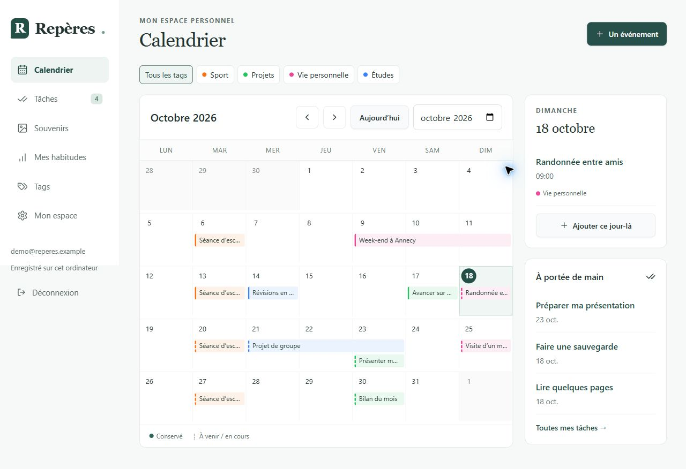

# Repères

**Un journal personnel pour retrouver ses rendez-vous, garder ses souvenirs et organiser ses tâches.**

Projet personnel de **Robin PLACE**, Repères rassemble un calendrier, des souvenirs illustrés, des tâches récurrentes et des suivis d’habitudes dans une interface en français, adaptée à l’ordinateur et au mobile.

**Next.js · React · TypeScript · SQLite · Supabase · Tailwind CSS**

## Le besoin

Les rendez-vous, les choses à faire et les souvenirs d’une même semaine se retrouvent facilement dispersés. Repères propose de les réunir dans un espace personnel : préparer les jours à venir, retrouver un événement passé et suivre quelques habitudes, sans changer d’outil.

## Ce que permet l’application

- **Organiser les journées** : calendrier mensuel, événements sur plusieurs jours, tags et recherche en français.
- **Conserver les souvenirs** : textes, lieux, personnes et photos rattachés aux événements.
- **Suivre les tâches** : priorités, échéances et récurrences à dates fixes ou depuis leur réalisation.
- **Observer les habitudes** : suivis hebdomadaires ou mensuels, compteurs manuels et objectifs.
- **Garder une copie de ses données** : export et restauration du contenu d’un compte avec ses photos.

[Voir les captures sur ordinateur et mobile](docs/captures.md) · [Ouvrir l’application](https://legendary-parakeet-seven.vercel.app/)

L’application en ligne demande un compte personnel. Les captures ci-dessus peuvent être consultées sans inscription et contiennent uniquement des données fictives.

## Choix techniques

L’interface utilise React et TypeScript dans une application Next.js. Un mode SQLite permet l’utilisation sur un ordinateur personnel ; Supabase fournit l’authentification et le stockage pour l’accès en ligne depuis plusieurs appareils.

Les données et les photos sont séparées entre comptes. Les dates sont traitées comme des jours civils afin de conserver la bonne journée malgré les changements d’heure. Les récurrences préservent leur jour d’origine, y compris après un mois plus court.

Les règles métier, les sauvegardes et l’API disposent de tests automatisés. Une vérification GitHub contrôle aussi la qualité du code et la construction de l’application.

[Lire les choix de conception et leurs compromis](docs/choix-techniques.md).

## Un projet qui évolue

Ce projet personnel réunit conception d’interface, règles métier, persistance, authentification, tests et mise en ligne. Les limites actuelles sont explicites : pas de notifications, de fonctionnement hors connexion ou de partage d’événements entre comptes. Les changements effectués depuis un autre appareil apparaissent après actualisation.

## Auteur et accès aux sources

**Robin PLACE** — [profil GitHub](https://github.com/Robin-Place).

Ce dépôt est la vitrine de Repères. Il contient une présentation et des captures de démonstration ; **le code source de l’application est conservé dans un dépôt privé**. Aucune licence publique de réutilisation du logiciel n’est accordée.

Présentation et captures © 2026 Robin PLACE. Tous droits réservés, sous réserve des droits et exceptions applicables et des fonctionnalités de consultation et de fork prévues par GitHub.
