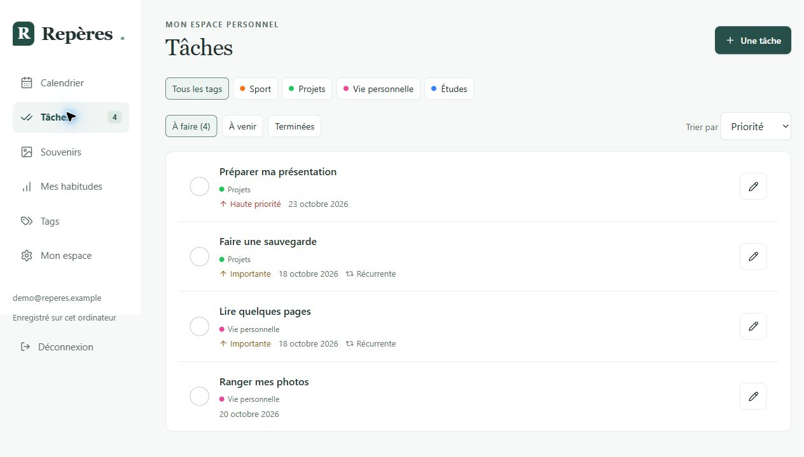
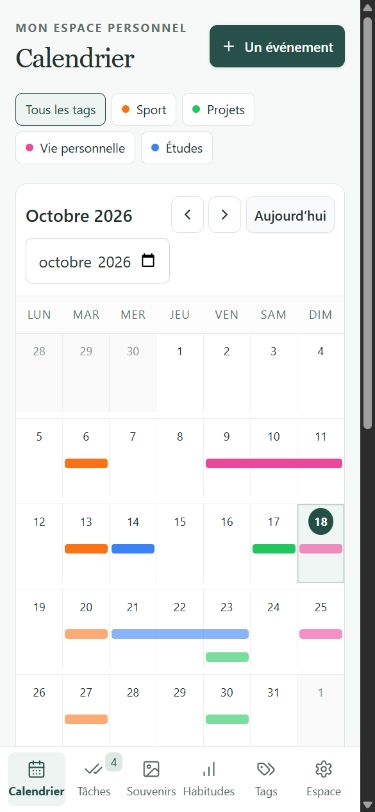

# Repères en images

Ces captures présentent l’application réelle exécutée localement avec des données entièrement fictives.

## Calendrier sur ordinateur

Les événements sur plusieurs jours, les tags et les détails permettent de réunir rendez-vous et souvenirs dans le même espace.

## Tâches et récurrences

Les tâches combinent priorités, échéances, tags et récurrences.

## Présentation mobile

La présentation s’adapte à un écran étroit. Cette capture ne remplace pas une vérification sur un téléphone réel.

[Revenir à la présentation du projet](../README.md).
